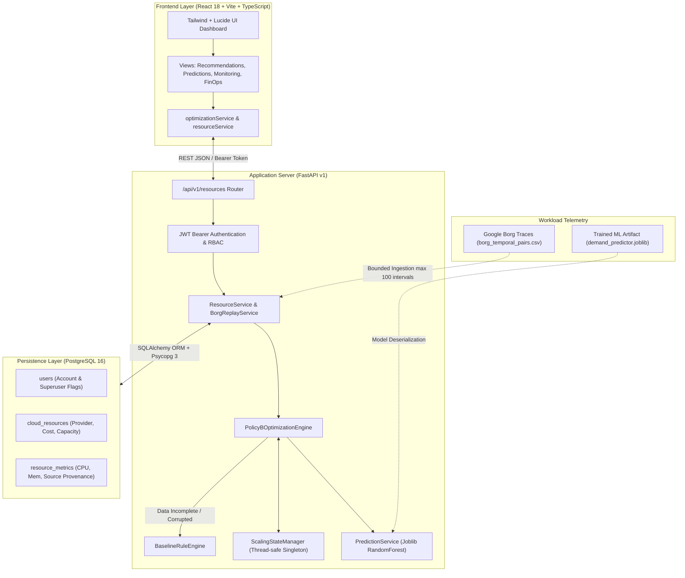
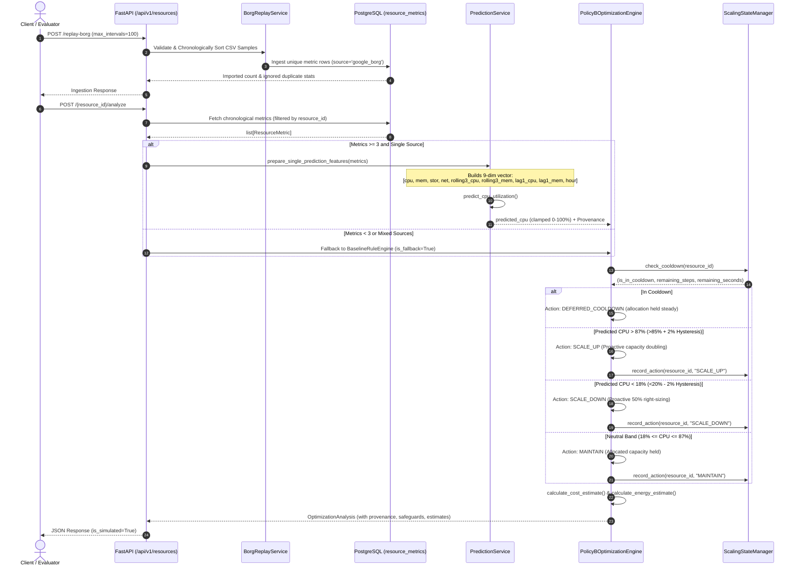
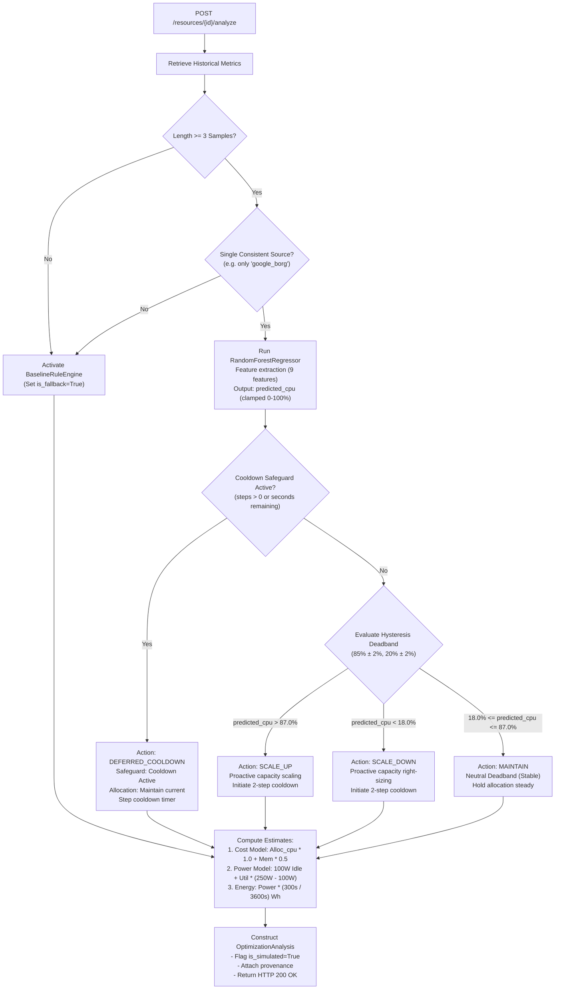

# CloudScale AI: Architecture & System Flows

This document details the concrete, implemented system architecture, data ingestion and inference pipeline, and optimization decision flows of the **CloudScale AI** platform.

---

## 1. End-to-End System Architecture

---

## 2. Telemetry Ingestion and Prediction Data Flow

---

## 3. Policy B Optimization & Safeguard Decision Flow

